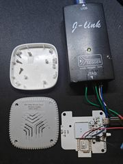

  <h1> zigbee-presence-custom</h1>
  
Custom firmware for Zigbee radar presence sensors

  
Lux-gated direct binding keeps lighting working through Home Assistant and automation downtime.

  
  
  
  

- **Local control:** occupancy sends On/Off directly to bound Zigbee devices and endpoints; no HA automations required.
- **Lux gating:** turn on only below your threshold, then stay on until occupancy clears. Threshold `0` always permits On.
- **Configurable:** radar sensitivity, range and off delay; settings survive power cycles.
- **Zigbee router:** relays mesh traffic and can parent up to six end devices.
- **Home Assistant:** configuration and telemetry through the included [ZHA quirk](quirks/zigbee_presence.py); OTA updates after the first wired flash.

Control can also survive coordinator downtime when powered peers retain a working mesh path.
HA outage operation is tested; coordinator power-loss operation remains untested.

## Supported models

| Model | Tested hardware | Photo |
| --- | --- | --- |
| **ZY-M100** | v1.3, original `_TZE204_ztc6ggyl`, ZS3L / EFR32MG21 |  |

Other models and board variants need separate validation. The factory IEEE and original radar MCU are retained.

## Get started

[Build and test](docs/build.md) · [Flash and recover](docs/hardware.md) · [Configure and bind](docs/configuration.md) · [Validation](docs/validation.md)

Experimental firmware. Current OTA images are unsigned and unencrypted.
[MIT license](LICENSE) · [Upstream attribution and SDK licensing](NOTICE)
